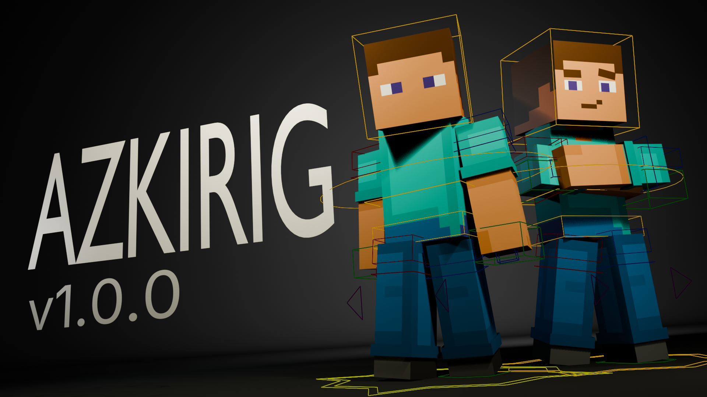

# AzkiRig

A simple, creator-friendly Minecraft character rig for Blender, designed for posing and rendering.

Created by AzkiVIP .

[⬇ Download Latest Stable Release](https://github.com/AzkiVIP/AzkiRig/releases/latest)

---

## Features

- Simple posing workflow
- Multiple arm types
- Lightweight setup
- Minecraft-focused rig design
- Lite and Face rig variants
- Included character, armor, and equipment textures

---

## Available Versions

| Version | Description | Status |
| --- | --- | --- |
| **AzkiRig Lite** | A simplified rig focused on posing and rendering. | Stable |
| **AzkiRig Face** | A face rig variant with eye controls and a foundation for facial animation. | Stable |

---

## Package Contents

| File or Folder | Description |
| --- | --- |
| `AzkiRig Lite.blend` | Lite rig file. |
| `AzkiRig Face.blend` | Face rig file. |
| `armor.blend` | Separate armor asset file. |
| `textures/` | Character and equipment textures. |
| `textures/equipment/leggings` | Leggings textures |
| `textures/m*.png` | Mouths texture |

The equipment textures include armor materials, leggings, a cape, and an elytra.

---

## Preview

### Render Showcase

---

## Releases

| Release | Type |
| --- | --- |
| [v1.0.0](https://github.com/AzkiVIP/AzkiRig/releases/tag/v1.0.0) | Latest stable release |

---

## Installation

### 1. Download and Extract

1. Open the [AzkiRig Releases page](https://github.com/AzkiVIP/AzkiRig/releases).
2. Choose the right version
3. Download the release package.
4. Extract the ZIP archive.

### 2. Open a Rig

Choose the variant you want to use:

- Open `AzkiRig Lite.blend` for the Lite rig.
- Open `AzkiRig Face.blend` to Face Rig.

The `armor.blend` file contains the separate armor assets.

### 3. Append a Rig into Your Project

1. Open your Blender project.
2. Select **File → Append**.
3. Browse to the rig `.blend` file you want to use.
4. Open the **Collection** directory.
5. Select the **AzkiRig Lite** or **AzkiRig Face** collection and append it.

### 4. Hide the Widgets

1. Go to outliner
2. Find **WGTS_Armature**
3. Uncheck the collection

### 5. Choose an Arm Type

AzkiRig includes multiple arm styles.

Enable the arm type you want to use. For unused arm types:

- Disable viewport visibility.
- Disable render visibility.
- Or hide the corresponding collection.

### 6. Enable and Disable the Armor, Cape, Elytra

1. Go to Outliner
2. Find Collection named **armor**, **cape**, **elytra**
3. Uncheck or Check the box

---

## License

See the [LICENSE](LICENSE) file for license details.

---

## Credits

Created by AzkiVIP .
